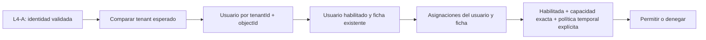

# F2 / L4-B — Autorización técnica por ficha

Base comprobada: `131cab7`, rama `feature/arquitectura-persistencia-pai`, árbol inicial
limpio. Se revisaron [L2](./L2_Modelo_Contratos.md), [L3](./L3_Persistencia_Memoria.md),
[L4-A](./L4A_Identidad_Entra.md), entidades, repositorios, UnitOfWork e identidad reales.
No se cambian contratos L2, persistencia L3 ni verificación criptográfica L4-A.

## Arquitectura y contrato

`src/application/authorization/service.ts` implementa FichaAuthorizationService.
Depende solo de entidades/tipos/errores y puertos de aplicación, sin Functions, HTTP,
JOSE ni adaptador de persistencia concreto. No se conecta a health ni al arranque.

Construcción mediante código confiable: tenant esperado, Clock y AssignmentValidityPolicy
obligatorios. No hay configuración por petición, proveedor de identidad alternativo,
estado global mutable o caché de decisiones. Las referencias inyectadas son dependencias
confiables: el servicio no protege frente a código servidor malicioso.

- `decide(context, identity, fichaId, capability)` retorna una decisión inmutable:
  `{allowed:false}` o `{allowed:true,userId,fichaId,capability}`.
- `requireAllowed` evalúa de nuevo y devuelve la concesión o lanza el AccessDeniedError
  existente, con mensaje fijo `Operación no permitida.`.
- Ambos requieren TransactionContext; no abren ni confirman otra transacción.
  La concesión es un resultado interno, nunca un token reutilizable de autorización.

L4-A debe autenticar cada petición futura antes de llamar al servicio. AuthenticatedIdentity
es un contrato estructural TypeScript, no una prueba criptográfica por sí mismo. El servidor
deberá obtenerla del IdentityValidator, nunca deserializarla del cliente ni confiar en un cast.
L4-B no vuelve a validar JWT, firma, audiencia, scopes OAuth o tolerancia temporal del token.

## Modelo de decisión

Solo se resuelve usuario mediante `findByIdentity(identity.tenantId, identity.objectId)`.
No se recibe UserId del solicitante. Se comprueban además las referencias devueltas por
repositorios para evitar concesiones por un resultado incoherente. Después se consulta
`fichas.findById` y `assignments.listByUserAndFicha`. Se exige usuario y asignación
habilitados. Una asignación deshabilitada no es una prohibición que anule otras concesiones:
simplemente no concede acceso. No existe modelo de denegaciones explícitas en L2.

Tenant incorrecto, usuario no reconocido/deshabilitado, ficha inexistente, capacidad
desconocida, ausencia de asignación exacta o vigencia no confirmada deniegan. No se infieren
permisos por dependencia compartida, correo, UPN, alias, subjectKey, roles M365 o scopes.
No hay administrador universal ni jerarquía entre las dos capacidades. Un fallo de repositorio,
reloj o política propaga el error sin conceder acceso: su traducción HTTP segura es trabajo
posterior y no debe reflejar causas internas. El servicio no registra tokens ni otros datos.

## Limitación contractual: vigencia

L2 contiene validFrom/validUntil, pero explícitamente deja la evaluación a una política
futura; no define inclusión de extremos. No se modifican sus interfaces ni se inventa una
regla institucional. Se añade una interfaz de aplicación separada, AssignmentValidityPolicy,
con `isApplicable(assignment, at): boolean`, pura y síncrona, requerida al construir el
servicio. Solo `true` concede; ausencia de implementación impide componer el servicio
operativo. No se suministra una política temporal predeterminada en src.

Las pruebas inyectan **exclusivamente como supuesto de laboratorio** el intervalo
`validFrom <= at < validUntil`, con null sin límite superior. Ese código permanece bajo
tests y fuera del build/publicación. Se prueban inicio futuro/exacto y fin pasado/exacto.
Antes de integrar endpoints debe acordarse la semántica temporal y proveerse una política
confiable revisada. Esta dependencia pendiente limita la integración, no modifica L2.

## Matriz sintética

| Actor de laboratorio | ALFA lectura | ALFA edición reporte | BETA lectura | BETA edición reporte |
|---|---|---|---|---|
| Gestor ALFA | Sí | Sí | No | No |
| Gestor BETA | No | No | Sí | Sí |
| Consultor ALFA | Sí | No | No | No |
| Usuario sin asignaciones | No | No | No | No |
| Usuario no reconocido/deshabilitado | No | No | No | No |

Estos nombres describen fixtures; el código no conoce roles gestor/consultor. Cada Sí
requiere su asignación vigente explícita. `poc:edit-report` no implica `poc:read`, ni
concede cualquier escritura distinta de la capacidad comprobada. No se definen efectos
de `poc-blocked`, revisiones, aprobaciones, cierres o procesos institucionales. El servicio
comprueba acceso por ficha; no crea, edita ni valida reportes ni evidencias.

## Consistencia y revocaciones

El futuro caso de uso deberá ejecutar dentro de UN `runAtomic`:

1. Cargar el recurso real (por ejemplo actividad del reporte) y derivar su ficha persistida.
2. Evaluar `requireAllowed` con ese contexto, identidad autenticada y capacidad exacta.
3. Verificar versión y condiciones de operación; resolver idempotencia revalidando acceso
   también para un replay; escribir, auditar y completar idempotencia en el mismo contexto.
4. Dejar propagar excepciones para revertir todo. No capturar AccessDeniedError para continuar.

Nunca comprobar una ficha enviada por el cliente y escribir un recurso de otra. No liberar
una transacción de comprobación para luego escribir usando la concesión anterior. La API
del servicio facilita el contexto común, pero no puede impedir que un consumidor servidor
incumpla el protocolo: los endpoints futuros necesitarán revisión y pruebas propias.

L3 serializa por instancia. Una revocación confirmada antes de iniciar la siguiente operación
se observa al releer, sin caché. En concurrencia manda el orden serial: una operación que
ya ocupa la transacción puede confirmar antes de la revocación en cola; no se promete
cancelación retroactiva. El servicio nunca modifica asignaciones o usuarios. Las pruebas
usan setEnabled y expectedVersion existentes para revocar/rehabilitar entre transacciones.
El contrato no permite cambiar capacidad/fechas ni crear asignaciones: no se añaden métodos.

SQL futuro deberá garantizar el mismo aislamiento sobre lecturas de usuario, asignaciones
y ausencia de filas. Una transacción de escrituras aislada no basta. Memoria no demuestra
seguridad SQL ni consistencia entre procesos.

## Pruebas y verificaciones

- Suite completa L1–L4-B: **132 pruebas aprobadas, 0 fallidas**; incluye 35 nuevas de
  autorización y 3 negativas de límites, además de las 94 previas.
- API: `npm test` ejecuta pretest → `npm run build`, incluyendo `check:boundaries`,
  `check:contracts` y compilación TypeScript. Todo correcto.
- Pruebas TypeScript adicionales: identidad obligatoria, contexto obligatorio, capacidades
  acotadas y política temporal requerida; el nuevo servicio se incorpora transitivamente
  al check de contratos sin Node/DOM mediante tests/types/authorization.ts.
- Casos: matriz ALFA/BETA, desconocidos, falta de asignaciones, habilitación, límites de
  política sintética, scopes/roles ignorados, ausencia de capacidades implícitas y
  herencia, denegaciones genéricas, revocación/rehabilitación y cambio de usuario.
- Transacciones sintéticas solo en tests: autorización + creación + auditoría + idempotencia,
  rollback integral, manipulación de actividad BETA, decisión anterior a revocación,
  revocación concurrente controlada por barreras sin sleeps, contextos cerrados e instancias
  independientes. No se implementa un caso de uso de escritura en src.
- Integración local de bibliotecas: token sintético firmado con RSA efímera → validador
  real L4-A con transporte OIDC/JWKS inyectado local → decisión L4-B. No se consultó Entra.
- Guard: bloquea integración HTTP, acceso directo a memoria desde aplicación y dependencia
  inversa de puertos hacia servicio. La lista de fuentes permitidas sigue siendo explícita.
- Frontend: `npm run build` correcto; conserva advertencia previa de bundle >500 kB.
- `git diff --check` y revisión adicional de archivos nuevos sin seguimiento: correctos.
  Solo cambios bajo api; no se instalaron dependencias ni se modificaron paquetes/lockfiles.

## Riesgos y decisiones pendientes

No se ejecutaron pruebas contra un tenant real, navegador, HTTP autenticado, SQL, Graph o
SharePoint. No se iniciaron Functions/Azurite: health y sus controles locales permanecen
intactos. No hay endpoints nuevos ni comprobación de evidencias integradas.

Requieren decisiones posteriores: política temporal definitiva, ciclo de vida/gestión de
asignaciones, roles y alcances de Planeación, estados de reporte, auditoría de denegaciones,
permisos para evidencias, clientes OAuth admitidos y composición segura de los futuros
endpoints. No se anticipan reglas institucionales ni permisos globales.

No se avanza a L5/L6/L7, no se crean recursos ni se realizan commit, push, PR o merge.
