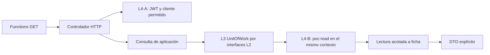

# F2 / L5 — Consultas HTTP autenticadas y autorizadas

**Estado:** completada en su alcance técnico local; pendiente de commit. Sin identificador
de commit L5. Este cierre no aprueba integración institucional ni despliegue productivo.
Base verificada: `a251e2a`, rama `feature/arquitectura-persistencia-pai`, árbol inicial limpio.
Se revisaron README, documentos L2–L4-B, entidades, contratos, registro Functions, health,
guard y pruebas. No se cambian contratos L2 ni reglas institucionales.

## Arquitectura



- `src/functions/index.ts`: carga health y los registros de consultas.
- `src/functions/fichas.ts`: registra solo GET, aplicando assertLocalEnvironment.
- `src/composition/queries.ts`: compone validador JWT real, reloj, memoria vacía, L4-B
  con bloqueo temporal explícito y consultas. No incorpora fixtures o claves sintéticas.
- `src/http/fichas.ts`: controlador reutilizado por Azure Functions y pruebas; obtiene
  Authorization, autentica, valida solicitud y mapea errores sin detalles internos.
- `src/application/queries/readFicha.ts`: autoriza y lee en el mismo runAtomic; usa solo
  interfaces L2 y L4-B. No accede al estado interno de memoria ni realiza escrituras.

El controlador no abre una transacción para comprobar permisos y otra para leer. Cada
consulta ejecuta requireAllowed y la lectura del recurso dentro del mismo contexto.
No hay caché de decisiones, listados globales, escritura HTTP, frontend ni cambios MSAL.

## Rutas y JSON sintéticos

`GET /api/poc/fichas/{fichaId}` devuelve exclusivamente los campos existentes de Ficha:

```json
{
  "data": {
    "id": "synthetic-ficha-alpha",
    "dependencyId": "DEP-ALFA",
    "cycleLabel": "synthetic-cycle",
    "version": "synthetic-initial-version"
  }
}
```

`GET /api/poc/fichas/{fichaId}/actividades` es viable porque L2 declara Activity.fichaId
y ActivityRepository.listByFicha. La consulta comprueba además que todas las filas
devueltas correspondan a la ficha; una incoherencia del adaptador produce 500 sin datos.

```json
{
  "data": [
    {
      "id": "synthetic-activity-alpha-1",
      "fichaId": "synthetic-ficha-alpha",
      "description": "Actividad sintética alpha-1",
      "version": "synthetic-initial-version"
    }
  ]
}
```

El array puede ser vacío. Los ejemplos no describen registros cargados en el host. Los
DTO se proyectan campo por campo: no se serializan usuarios, asignaciones ni propiedades
adicionales que un adaptador pudiera incluir. La versión sigue siendo un token opaco.
La colección no tiene paginación en L2; su uso se limita al dataset sintético acotado.

## Solicitud y respuestas

Cada petición configurada valida un único Bearer mediante L4-A antes de inspeccionar ID
o acceder al repositorio. Los headers Authorization duplicados fusionados por Headers
contienen comas y L4-A los rechaza; no se aceptan encabezados de suplantación. No se
lee identidad, tenant, usuario ni capacidad del cuerpo/query. La capacidad siempre es
`poc:read`, elegida en el servidor, nunca `poc:edit-report` por inferencia.

Restricción HTTP local: ID de 1–128 caracteres ASCII, primer carácter alfanumérico y
resto alfanuméricos, punto, guion o guion bajo; sin espacios, controles, porcentajes ni
separadores de ruta. Los params son los entregados por Functions; no se vuelven a
decodificar. Es una restricción de transporte PoC, no un cambio del tipo opaco L2.
Se rechazan query parameters, cuerpo y método distinto de GET en el controlador;
Functions solo registra GET. No se registra ninguna operación POST/PUT/PATCH/DELETE.

| Código | Comportamiento |
|---|---|
| 200 | JWT válido, usuario/ficha/asignación habilitados, política aplicable y poc:read explícito; DTO mínimo |
| 400 | Tras autenticar, ID ausente/mal formado o solicitud fuera del contrato |
| 401 | Authorization ausente, ambiguo, JWT inválido/vencido, audiencia/emisor/tenant/scope/cliente rechazados; WWW-Authenticate: Bearer |
| 403 | Reservado, no emitido por estas rutas: los rechazos por recurso se ocultan como 404 |
| 404 | Ficha inexistente o no visible, usuario no reconocido/deshabilitado, sin asignación o capacidad; respuesta idéntica |
| 500 | Error inesperado o configuración local ausente/incorrecta, sin información interna |

Se elige **404 uniforme** para todos los rechazos de autorización sobre recursos; devolver
403 solo para fichas existentes revelaría su existencia frente a un 404 por ausencia.
Ambas rutas se prueban comparando cuerpo y headers completos de ficha ajena/inexistente.
No se promete tiempo constante ni protección completa frente a canales temporales.

```json
{"error":{"code":"NOT_FOUND","message":"Recurso no disponible."}}
```

Los otros códigos JSON son INVALID_REQUEST, UNAUTHENTICATED e INTERNAL_ERROR, con
mensajes estáticos. Todas las respuestas del controlador usan application/json,
Cache-Control: no-store y X-Content-Type-Options: nosniff. No se registran JWT, claims,
stack traces o errores originales. Fallos de claves/red controlados por L4-A deniegan
autenticación; fallos internos no reconocidos producen 500. No hay fallback de identidad.

## Corrección mínima previa de L4-A: azp

Se detectó y comunicó antes de integrar HTTP que azp se comprobaba solo como GUID.
Esta etapa exige validar también el cliente llamante. Se añade allowedClientIds a
IdentityConfiguration (configuración de infraestructura, **no contrato L2**): lista
obligatoria de 1–100 GUID válidos, normalizada, deduplicada, copiada y congelada.
No admite lista vacía, wildcard ni valor predeterminado. normalizeIdentity comprueba
pertenencia después de jwtVerify. No cambia RS256, audiencia, emisor, vigencia, scope
ni resolución de claves. Los fixtures existentes explicitan solo el cliente sintético.

Referencia: [Microsoft, validación de sujeto y actor](https://learn.microsoft.com/en-us/entra/identity-platform/claims-validation).
La lista no concede acceso por ficha; L4-B sigue resolviendo tenantId + objectId y
comprobando las asignaciones persistidas actuales. Los roles M365 no las sustituyen.

## Composición local y límites operativos

package.json apunta a `.local-build/functions/index.js`; el lanzador conserva loopback
127.0.0.1:7071 y selecciona pocHealth, pocFicha y pocFichaActividades. `.funcignore`
sigue excluyendo todo de publicación; las defensas de alojamiento no cambian.
Health conserva exactamente su código/contrato y no depende de configuración JWT.

La composición lee únicamente `PAI_API_IDENTITY_CONFIG`, JSON explícito con los campos
de IdentityConfiguration: tenantId, audience, requiredScope, metadataUrl, jwksUrl,
tokenVersion, clockToleranceSeconds y allowedClientIds. No se genera archivo ni valor
institucional ni se requiere secreto. La validación operativa utilizó valores ficticios
solo en el entorno del proceso de prueba; no se guardó configuración institucional.
Se valida al construir sin descargar OIDC/JWKS. Ausencia/JSON inválido/configuración
incompleta da handlers 500 genéricos, sin impedir health ni exponer el contenido.

Con configuración válida se usa el validador real. Una solicitud con JWT podría iniciar
la resolución real de metadatos; **no se ejecutó ese flujo contra Entra**, ni se autoriza
hacerlo aquí. Las pruebas bloquean fetch global e inyectan transporte OIDC/JWKS local.
No hay bandera mock, claves sintéticas en src ni carga de fixtures desde el entorno.

La memoria del host empieza vacía y persiste solo durante la vida de esa composición por
worker. No existe cargador de usuarios o asignaciones. La política temporal de composición
devuelve false como bloqueo preventivo, no como regla de vigencia institucional. Por tanto
el host actual no ofrece respuestas 200 de datos: faltan una política revisada y composición
de datos autorizada. Los 200 son pruebas del controlador real con DI solo en tests.

L2/L4-B no fijan extremos temporales. Las pruebas emplean únicamente el supuesto sintético
`validFrom <= instante < validUntil` (null sin fin). No se incorpora como política operativa.
Definir vigencia institucional y habilitar acceso con Entra real siguen pendientes.

## Pruebas y validación

- API build, contratos TypeScript sin Node/DOM y guard de límites: correctos.
- Suite completa: **182 pruebas aprobadas, 0 fallidas**, incluidas las 132 previas,
  corrección azp, controladores HTTP, registro/rutas y controles de separación L5.
- Los tests usan HttpRequest real de @azure/functions, el mismo controlador registrado,
  JWT sintéticos firmados con RSA efímera, L4-A/L4-B reales y memoria L3. No se limita
  la prueba a un mock de autorización. Fetch global bloqueado en las pruebas HTTP.
- Ambas rutas cubren falta/ambigüedad de token, firma/vigencia/audiencia/emisor/tenant,
  Graph/ID token SPA/scope/azp, falta de permisos, usuario desconocido/deshabilitado,
  acceso cruzado, ID mal formado, intentos de suplantación y errores sin filtraciones.
- Se prueban DTO exactos, actividades vacías, adaptador que devuelve filas ajenas,
  revocación entre peticiones, consulta concurrente/revocación mediante barreras,
  independencia de instancias y ausencia de cambios en entidades/versiones/auditoría/
  idempotencia tras GET autorizados o denegados. No se crea servicio de escritura.
- Registro: comprobación AST de rutas, métodos GET, callbacks y entrypoint; controladores
  ejercidos en proceso en la suite automatizada. La verificación posterior del host vivo
  y sus peticiones HTTP se documenta a continuación como evidencia separada.
- Frontend build correcto; conserva advertencia previa de bundle >500 kB.
- git diff --check, revisión de archivos nuevos, status, stat y listado sin seguimiento
  revisados. Sin cambios en frontend/MSAL, dependencias/lockfiles, dominio ni puertos L2.

## Validación operativa local — 19/10/2026

Se compiló nuevamente la API y se iniciaron los lanzadores documentados de Azurite y
Azure Functions Core Tools 4.16.0 (runtime 4.1054.250.26428). El host registró las tres
funciones GET: pocHealth, pocFicha y pocFichaActividades. Antes de enviar HTTP se
verificaron listeners exclusivos en 127.0.0.1:7071, :10000, :10001 y :10002.

Se ejecutaron **nueve peticiones HTTP reales**: tres rutas en tres configuraciones.
Se usó `synthetic-ficha-alpha` únicamente como segmento de URL, sin cargar ese registro.

| Configuración del proceso | GET health | GET ficha sin token | GET actividades sin token |
|---|---|---|---|
| JWT estructural válida con identificadores ficticios | 200 | 401 | 401 |
| JWT incompleta | 200 | 500 genérico | 500 genérico |
| JSON de configuración inválido | 200 | 500 genérico | 500 genérico |

Health devolvió su JSON habitual:

```json
{"status":"ok","service":"pai-api-poc","stage":"L1","mode":"local-only"}
```

Las respuestas 401 incluyeron WWW-Authenticate: Bearer y el cuerpo:

```json
{"error":{"code":"UNAUTHENTICATED","message":"Autenticación requerida."}}
```

Ante configuración incompleta o inválida, las rutas protegidas devolvieron:

```json
{"error":{"code":"INTERNAL_ERROR","message":"No fue posible procesar la solicitud."}}
```

No se observó filtración de información sensible en las respuestas. Se comprobó además
que un marcador sintético de configuración no apareciera en respuestas ni logs revisados.
Los cuatro archivos stderr quedaron vacíos; no aparecieron avisos de almacenamiento
Unhealthy ni Unable to create client for AzureWebJobsStorage en los logs del host.
Es evidencia de esta ventana local, no garantía general de seguridad o disponibilidad.

Los resultados y logs se conservaron en `api/.test-tmp/l5-http-operational/`, ignorado
por Git: http-valid-results.json, http-incomplete-results.json, http-invalid-results.json,
host-valid/incomplete/invalid.stdout.log y storage.stdout.log, con sus stderr asociados.
No forman parte del contenido versionado. Las variables temporales del proceso lanzador
se restauraron; no se utilizaron tokens, credenciales reales ni peticiones a Entra.
No se cargaron fixtures en el host ni se habilitó una política temporal permisiva.

Al terminar se detuvieron Functions y Azurite y se verificó ausencia de listeners en los
cuatro puertos. La comparación SHA-256 de los 19 archivos L5 confirmó que la prueba
operativa no modificó código, pruebas ni documentación. git diff --check fue correcto.

## Limitaciones y siguiente etapa

L5 queda **completada exclusivamente en su alcance técnico local, pendiente de commit**.
No se probó navegador, HTTP con tokens reales y datos operativos, Entra real, SQL, Graph
o SharePoint. El host conserva memoria vacía y política temporal de asignaciones pendiente;
los 200 de datos siguen demostrados solo por DI en pruebas automatizadas. Faltan
composición de datos revisada y validación institucional. No hay paginación, rate limiting
ni observabilidad operativa definitiva; estos límites no habilitan despliegue productivo.
L6 — Escrituras HTTP es la siguiente etapa, todavía no iniciada y sujeta a autorización.
No se crean recursos, instalan paquetes ni implementan L6/L7; no se realiza commit/push/PR/merge.
