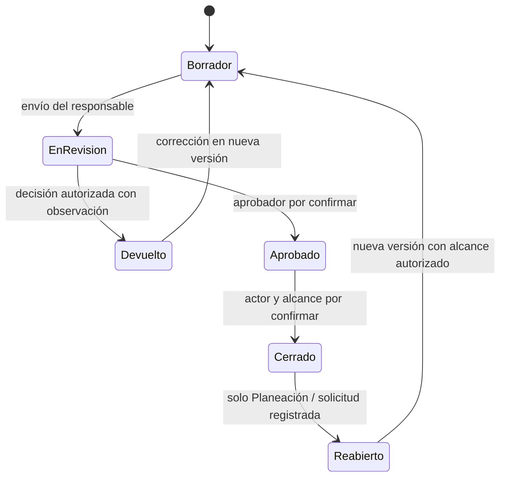

# PAI-003 — Reglas de negocio y cálculo: base para validación

Versión 0.1 para revisión, 16 de octubre de 2026. Rama `feature/analisis-funcional-pai`.

## 1. Evidencia y estados

**Q:** [Cuestionario respondido](<../../insumos/planeacion/PAI_Digital_Revision_Requisitos_Planeacion cuetionario resuelto..docx>), §§1–7, revisión 15/10/2026, resultado «Aprobado con ajustes». **X:** [Excel V1 (6)](<../../insumos/planeacion/01. Plan de Acción 2026 Consolidado V1 (6).xlsx>), fórmulas leídas de XML, incluidas fórmulas compartidas expandidas por referencia relativa. [PAI-006](../03-arquitectura/PAI-006_Diccionario_Excel.md) contiene inventario y controles. Los HTML de referencia no son fuente de cálculo.

Estados: **expresa** = respuesta directa de Planeación, sujeta al ajuste general; **observada** = comportamiento del Excel que aún necesita ratificación; **propuesta** = diseño para preservar información o probar la regla, no aprobación funcional. P-xx remite a [PAI-004](PAI-004_Pendientes_Planeacion.md).

## 2. Reglas expresadas por Planeación

| Regla | Enunciado y alcance | Fuente / RF | Restricción o pendiente |
|---|---|---|---|
| RN-01 | La estructura contempla línea/eje, iniciativa/objetivo, compromiso/programa/proyecto, meta e indicador | Q §1; RF-001–004 | Catálogo y cardinalidades definitivas P-07; no equiparar automáticamente términos |
| RN-02 | Conservar fichas, índice y consolidado; controles de calidad deben ocurrir en formulación, sin reproducir hojas auxiliares como módulos | Q §2; RF-001–016 | Suprimir una hoja de control no elimina la validación que realizaba |
| RN-03 | La suma de pesos de actividades por meta debe ser 100 % | Q §4.1; RF-005 | No implica que toda meta deba cumplir 100 %. Tolerancia, momento de bloqueo y excepciones P-01 |
| RN-04 | El responsable de la ficha reporta; puede ser líder de dependencia, director de sede o programa | Q §4.3; RF-019 | Delegación y asignaciones históricas P-17 |
| RN-05 | Capturar logros cuantitativos con enteros o decimales además de su descripción | Q §§1, 3 B; RF-009–012 | Unidad, precisión, rangos y obligatoriedad P-20, P-06 |
| RN-06 | El cumplimiento calculado de actividades y el resultado del indicador de la meta son magnitudes distintas | Q §4.7; RF-004, 009–010 | No derivar el resultado de meta sumando porcentajes de actividades; definición de indicador P-02 |
| RN-07 | Planeación valida evidencias y consolida; vicerrectores consultan avance; rector y Consejo Superior reciben informes | Q §4.3; RF-015, 020–024 | Aprobador final, visibilidad de borradores y segregación de funciones P-03 |
| RN-08 | Solo Planeación reabre un PAI cerrado; vicerrectores pueden solicitarlo | Q §4.3; RF-020, 022 | Alcance de «PAI cerrado», vencimiento de apertura y actor del cierre P-04 |
| RN-09 | El responsable ajusta evidencias para el próximo periodo; una corrección en el mismo trimestre tras cierre requiere autorización del vicerrector | Q §4.4; RF-021–022 | Coordinar autorización con la reapertura exclusiva de Planeación; no son el mismo acto: P-04 |
| RN-10 | Conservar anotaciones de Planeación y generar informe de modificaciones posteriores al cierre | Q §4.4; RF-014, 022 | Retención, consulta y contenido mínimo P-15, P-12 |
| RN-11 | Solo Planeación modifica actividades y programación; la ponderación puede cambiar si cambia la actividad | Q §4.5; RF-005–006, 017 | Solicitud aprobada según §3 A; quién aprueba y efecto en reportes previos P-05 |
| RN-12 | No modificar metas después de iniciado el año | Q §4.5; RF-003, 017 | Fecha de congelación, corrección material, altas y bajas P-05, P-15 |
| RN-13 | Permitir exportación trimestral Excel para consulta y Power BI | Q §4.8; RF-024 | Corte, versiones y formato P-12 |
| RN-14 | Inicio desde 2027 y horizonte de diez años según respuesta | Q §4.6; RF-026 | No fijar último año hasta resolver P-08; no importar 2026 sin aprobación P-09 |

Q §1 pide eliminar/modificar filas y §3 A menciona solicitud aprobada; RN-12 restringe esa capacidad. La regla más general no autoriza borrar o modificar una meta ya formulada. La resolución debe registrarse en P-05/P-15.

## 3. Fórmulas originales y significado observado

Las fórmulas se transcriben en la sintaxis inglesa almacenada en XLSX; se conserva `=`. No son una fórmula oficial única aprobada. Se inspeccionaron expresiones y cachés del archivo, **sin recalcular Excel**. Una caché puede ser antigua y no valida su expresión.

### 3.1 Programación, valores reportados y cálculo trimestral

| Celda | Fórmula original | Lectura observada |
|---|---|---|
| `VA01!M9` | `=SUM(I9:L9)` | Suma programación T1–T4 |
| `GTI05!T9` | `=SUM(P9:S9)` | Suma valores reportados T1–T4 |
| `Consolidado!K2` | `=IF(ISBLANK('VA01'!I9),"",'VA01'!I9)` | Conserva blanco de la ficha, sin convertirlo automáticamente en cero |
| `Consolidado!O2` | `=SUM(K2:N2)` | Total programado de la fila consolidada |
| `Consolidado!V2` | `=SUM(R2:U2)` | Total reportado de la fila consolidada |
| `Consolidado!W2` | `=IF(K2="","",IFERROR(MIN(R2/K2,1),0))` | T1: blanco si programación vacía; cociente reportado/programado con techo 1; error convertido a 0 |
| `Consolidado!X2` | `=IF(L2="","",IFERROR(MIN(S2/L2,1),0))` | T2 con la misma estructura |
| `Consolidado!Y2` | `=IF(M2="","",IFERROR(MIN(T2/M2,1),0))` | T3 con la misma estructura |
| `Consolidado!Z2` | `=IF(N2="","",IFERROR(MIN(U2/N2,1),0))` | T4 con la misma estructura |

Observaciones que deben ratificarse (P-01/P-20):

- Un trimestre vacío devuelve texto vacío y no entra en `AVERAGE`; un trimestre programado con avance vacío puede resultar en 0. Esto no define por sí solo «sin reporte», «no aplica» o «retrasado».
- `MIN(...,1)` limita el sobrecumplimiento de actividades, pero no contiene un mínimo 0; no hay una regla demostrada para negativos. Un denominador cero queda oculto por `IFERROR` como 0 en estas expresiones.
- La suma anual de cantidades es el comportamiento de algunas columnas, no una regla válida para cualquier indicador porcentual, monetario, acumulado o sí/no. No hay definición suficiente para todos los tipos.
- Q §4.2 remite al consolidado; no describe tratamiento explícito de cierres, futuros trimestres, arrastre de atrasos o agregación por línea. Son decisiones abiertas.

### 3.2 Ponderación y anual

`Consolidado!AA2`:

```text
=IFERROR(IF(AVERAGE(W2:Z2)/AVERAGE(W2:Z2),AVERAGE(W2:Z2)*J2,0),0)
```

`Consolidado!AD2`:

```text
=IFERROR(IF(AVERAGE(W2:Z2)/AVERAGE(W2:Z2),AVERAGE(W2:Z2)*J2,0),0)/J2
```

AA calcula, cuando existe promedio no nulo válido, promedio de los cuatro porcentajes por el peso `J2`; la división del promedio por sí mismo actúa como condición y los errores se convierten a 0. AD vuelve a dividir por el peso **fuera** del `IFERROR`; con peso cero podría fallar. Este AD no es una medición del indicador de resultado. En las 785 filas del consolidado, W:Z y AA siguen estos patrones; AD contiene 779 fórmulas, dos ceros fijos (`AD487`, `AD717`) y cuatro celdas sin contenido (`AD36:AD37`, `AD100:AD101`).

Ejemplo concreto de ficha: `GTI05!H9=0.8`; J9 y L9 programan 1 en T2 y T4. Q9 reporta 1 y S9 está vacío. U9 y W9 quedan vacíos; V9 calcula 1 y X9 calcula 0; Y9 usa:

```text
=IFERROR(IF(AVERAGE(U9:X9)/AVERAGE(U9:X9),AVERAGE(U9:X9)*H9,0),0)
```

La caché guardada de Y9 es 0.4, consistente con promedio 0.5 × peso 0.8. Esto ilustra que un trimestre futuro programado puede entrar en el denominador; no autoriza presentar el 50 % como cumplimiento del periodo T2 ni como indicador de la meta. Validar corte y significado de anual en P-01/P-18.

### 3.3 Métodos incompatibles que requieren conciliación

| Celda | Expresión original | Problema a resolver |
|---|---|---|
| `FCS02!Y9` | `=SUM(U9:X9)` | Suma porcentajes, sin peso en esta celda; no coincide con anual ponderado del consolidado |
| `BB19!Y9` | `=IF(M9="","",IFERROR(MIN(T9/M9,1),0))` | Razón anual total, distinta del promedio trimestral ponderado |
| `FC05!Y19` | `=IFERROR(IF(AVERAGE(W19:X19)/AVERAGE(W19:X19),AVERAGE(W19:X19)*H19,0),0)` | Promedia solo T3 y T4 |
| `ME03!Y15` | `=IFERROR(IF(AVERAGE(V15:X15)/AVERAGE(V15:X15),AVERAGE(V15:X15)*H15,0),0)` | Promedia T2–T4 |
| `FISP04!W37` | `=IFERROR(IF(AVERAGE(S37:V37)/AVERAGE(S37:V37),AVERAGE(S37:V37)*F37,0),0)` | Ubicación y referencias atípicas: F es texto de actividad; no asumir desplazamiento correcto |
| `PS011!V10` | `=IF(J10="","",IFERROR(MIN(R10/J10,1),0))` | Usa valor de T3 para columna de T2 |
| `PLA02!V31` | `=IF(K31="","",IFERROR(MIN(Q31/K31,1),0))` | Usa programación de T3 para evaluación T2 |

Hay 32 celdas con valores fijos en U:Y dentro de las filas de negocio detectadas; ejemplos `VA01!W27=1`, `Fo07!U27=0.99`. No confundir intervención manual con resultado del motor ni recalcularla sin autorización. El inventario ampliado de excepciones está en PAI-006.

### 3.4 Errores de referencia confirmados

| Celda | Fórmula original |
|---|---|
| `PS011!W10` | `=IF(K10="","",IFERROR(MIN(#REF!/K10,1),0))` |
| `NDSP14!X10` | `=IF(L10="","",IFERROR(MIN(#REF!/L10,1),0))` |
| `VE01!X14` | `=IF(#REF!="","",IFERROR(MIN(S14/#REF!,1),0))` |
| `VE01!X18` | `=IF(#REF!="","",IFERROR(MIN(S18/#REF!,1),0))` |

`IFERROR` o una programación vacía pueden esconder una referencia rota; no basta buscar errores visibles en resultados guardados. Los cuatro casos quedan bloqueados para homologación automática.

## 4. Actividad frente a resultado de la meta

| Concepto | Origen | Representación conceptual propuesta | Prohibición de inferencia |
|---|---|---|---|
| Cantidad programada de actividad | I:L de ficha | Programación por actividad y trimestre, con unidad | No siempre es porcentaje |
| Logro cuantitativo de actividad | P:S | Detalle de reporte, con valor decimal y unidad | No sustituirlo por la narración |
| Cumplimiento de actividad | U:X; W:Z consolidado | Cálculo derivado con fórmula/versiones aprobadas | No asignarlo al indicador de meta |
| Aporte ponderado de actividad | H y Y; J y AA consolidado | Resultado derivado con peso y versión | No equivale a valor del indicador de resultado |
| Definición de indicador de meta | G, variable por fila | Definición(es) de indicador pendiente(s) de conciliación | G no contiene una medición estructurada uniforme |
| Medición del indicador de resultado | Q §4.7; no columna separada uniforme identificada | Medición por meta/indicador, periodo y corte | No fabricarla a partir del promedio de actividades |

Q permite que todas las actividades estén al 100 % y el indicador de resultado no se alcance. Tipos, numerador/denominador, línea base, meta objetivo, sentido del indicador y acumulación deben definirse en P-02/P-20. No se fija una fórmula universal para estos indicadores.

## 5. Ciclo de reporte propuesto para discusión

El siguiente diagrama conceptual no fija estados oficiales, plazos ni permisos aún ambiguos. Se apoya en RF-020–022 y Q §4.3–4.4. «Cierre» puede corresponder a trimestre, ficha o vigencia: P-04 debe resolverlo antes de implementarlo.



La autorización de un vicerrector para ajustar evidencias no se representa como apertura directa: debe quedar vinculada a la solicitud y a la actuación de Planeación. Cambiar una actividad/programación constituye otro tipo de solicitud; no se deduce de una reapertura de reporte.

## 6. Controles propuestos, no reglas confirmadas

- Identificadores internos estables; unicidad contextual y conservación del código original y su procedencia.
- Separar blanco, cero, sin reporte y no aplicable; validaciones reproducidas en el servicio, no solo en formularios.
- Conservar versiones de estructura, programación, peso, cálculo y reporte para reproducir un corte histórico.
- Registrar decisiones con actor, instante, motivo y versión objeto; correcciones mediante nuevos eventos, sin reescribir decisiones anteriores.
- Una devolución genera una nueva oportunidad de edición según permisos acordados; una observación no equivale a una aprobación.
- No borrar físicamente evidencia revisada ni sustituirla sin conservar la versión; retención y bajas requieren P-15.
- No conceder permisos por ocultar una vista. Separar identidad Entra, asignación a ficha y autorización de operación.

## 7. Casos de validación que Planeación debe resolver

| Caso | Datos de entrada / referencia | Resultado que sí se conoce | Respuesta pendiente |
|---|---|---|---|
| CAL-01 | Trimestre sin programación; `GTI05!I9` | Fórmula U9 devuelve vacío | ¿No aplica o ausencia de programación? ¿Se permite reportar allí? |
| CAL-02 | Programación 0, reporte positivo | Patrón trimestral transforma división errónea en 0 | ¿Rechazar, reprogramar o medir de otra forma? |
| CAL-03 | Reporte mayor que programación | `MIN(...,1)` trunca a 1 en el patrón | ¿Conservar sobrecumplimiento en consulta y en indicador de resultado? |
| CAL-04 | Futuro trimestre programado sin reporte; `GTI05!Y9` | Caché 0.4 ponderada | ¿Denominador anual completo o solo periodos vencidos/al corte? |
| CAL-05 | Pesos de `ADQ06-M01` suman 1.2 | Contradice RN-03 | ¿Corrección aprobada de origen y efecto retroactivo? |
| CAL-06 | Peso 0 en AD del consolidado | División final no protegida | ¿Permitido el peso 0? ¿Cómo presentar cumplimiento? |
| CAL-07 | 100 % de actividades, resultado de meta menor | Situación admitida por Q §4.7 | Fórmula y escala específicas del indicador |
| CAL-08 | Fórmula sumada frente a razón de totales frente a promedio ponderado | Tres métodos observados | ¿Cuál corresponde a cada tipo/caso y cómo se agregan metas/líneas? |

No se implementó un motor de cálculo ni se declararon estas pruebas aprobadas. Los resultados oficiales esperados deben quedar firmados o registrados por Planeación antes de codificar RF-010.
