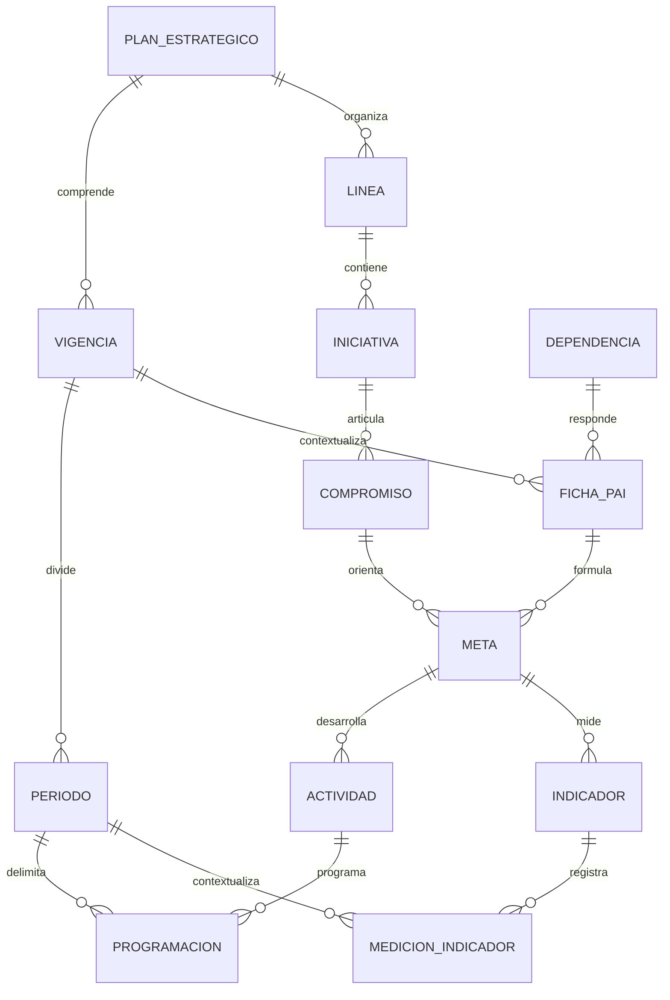
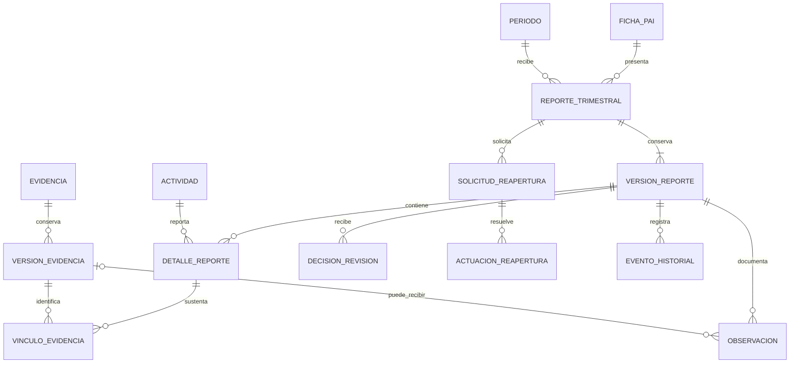

# PAI-005 — Modelo conceptual de datos y permisos preliminares

Versión 0.1 propuesta para validación, 16/10/2026. Rama `feature/analisis-funcional-pai`.

## 1. Alcance y trazabilidad

Fuentes: [cuestionario respondido](<../../insumos/planeacion/PAI_Digital_Revision_Requisitos_Planeacion cuetionario resuelto..docx>) (Q §§1–4, revisión «Aprobado con ajustes»); [Excel V1 (6)](<../../insumos/planeacion/01. Plan de Acción 2026 Consolidado V1 (6).xlsx>) (X, especialmente `Consolidado!A1:AD2`, `GTI05!D8:Y9`, encabezados trimestrales); [arquitectura actual](../arquitectura-actual-pai.md). Reglas y decisiones: [PAI-003](../02-requisitos/PAI-003_Reglas_Negocio.md) y [PAI-004](../02-requisitos/PAI-004_Pendientes_Planeacion.md).

Es un **modelo lógico-conceptual propuesto**, independiente del motor de almacenamiento. No crea tablas, listas, bibliotecas, permisos ni código. Las entidades técnicas preservan información; sus cardinalidades no sustituyen la validación funcional. No hay equivalencia «una hoja = una entidad» o «una fila = una meta».

## 2. Identidad y estructura de planeación

Hipótesis a validar: una meta pertenece a una ficha y a un compromiso principal; una ficha a una dependencia y vigencia. La estructura plurianual, el alcance de una ficha por sede/programa y la relación iniciativa/compromiso requieren P-07/P-08/P-17. Si una meta tiene múltiples articulaciones, se necesitará una relación asociativa explícita; no duplicar la meta. Se admite conceptualmente más de un indicador para no perder variaciones de G, **sin afirmar que todos son indicadores de resultado válidos** (P-02).

### Entidades y atributos conceptuales

| Entidad | Atributos propuestos | Relación con origen / decisión |
|---|---|---|
| PlanEstrategico | id, nombre, fecha inicial/final, versión/estado | Q §1 y horizonte §4.6; no hay catálogo estructurado de plan en X; P-08 |
| Vigencia | id, año, plan, estado, calendario aprobado | `Consolidado!AB`; inconsistente, necesita P-18 |
| Periodo | id, vigencia, número T1–T4, inicio/fin, fechas de reporte/cierre | I:L/P:S de fichas; fechas operativas no están definidas (P-04/P-11) |
| Linea | id, código, nombre, plan | `Consolidado!B`; no inferir toda estructura 2027 de 2026 |
| Iniciativa | id, código si existe, nombre, línea | A de ficha, C consolidado; código no uniforme identificado |
| Compromiso | id, descripción, iniciativa, clasificación opcional | B de ficha, D consolidado; programa/proyecto/componente P-07 |
| Dependencia | id, código canónico, nombre, tipo, relación organizativa opcional, estado | `Resumen!A:B`, `Consolidado!A`; sede/programa no son sinónimos automáticos |
| FichaPAI | id, vigencia, dependencia/unidad responsable, versión de formulación, estado | Fichas visibles y Q §1; clave de negocio definitiva P-17 |
| Meta | id, ficha, compromiso, código de negocio, descripción, versión | D:E de ficha; conservar la identidad al cambiar una actividad; congelación RN-12 |
| FuentePlaneacion | id, referencia, tipo opcional | C de ficha; propuesta de asociación MetaFuente N:M si hay varias referencias en una celda, por validar |
| Actividad | id estable, meta, descripción, peso, producto, presupuesto/unidad, versión/vigencia de cambio | F, H, N, O; no existe código de actividad uniforme en las fichas |
| Programacion | id, actividad/version, periodo, cantidad prevista, unidad, estado de captura | I:L; distinguir ausente, cero y no aplicable según P-01/P-20 |
| Indicador | id, meta, nombre, nivel/tipo por conciliar, unidad, línea base, objetivo, sentido y fórmula versionada | G y Q §4.7; atributos no estructurados en X son propuesta, no datos inferidos |
| MedicionIndicador | id, indicador, periodo/corte, valor/numerador/denominador cuando corresponda, unidad, autor, fecha, versión | Necesaria por Q §4.7; no identificada como columna única en X |
| ReglaCalculo | id, nombre, versión, vigencia de aplicación, definición aprobada y referencia de aprobación | Propuesta para RF-010; no contiene aún fórmula oficial única |
| ResultadoCalculo | id, actividad/meta según nivel, corte, regla/version, entradas/versiones, porcentaje, aporte ponderado, fecha | Derivado, no sustituto de MedicionIndicador; conservar para reproducir exportaciones |

La fuente de planeación puede tener asociación N:M con metas; no se fija una tabla física ni se divide automáticamente texto libre por comas. Un valor de resultado monetario o sí/no no se convierte siempre en porcentaje.

## 3. Reportes, evidencias y revisión

La granularidad propuesta es un reporte por ficha/periodo, con detalles por actividad. Q no decide si el envío/aprobación se hace por ficha o por actividad; P-03 debe validarlo. Las cardinalidades del diagrama son hipótesis de diseño y no restricciones ya impuestas. Si el cierre es por vigencia o periodo global, la solicitud de reapertura debe vincular además ese objeto de cierre; no forzar todo a un reporte.

| Entidad | Contenido propuesto | Requisito / restricción |
|---|---|---|
| ReporteTrimestral | id, ficha, periodo, estado de proceso, versión vigente y responsable | RF-009, 019–020; estados oficiales P-03/P-04 |
| VersionReporte | id, reporte, número, autor, fechas de creación/envío, versión de estructura/programación, versión previa | Conservar el envío evaluado y una nueva versión al corregir; RF-022 |
| DetalleReporte | id, versión, actividad/version, logro cuantitativo y unidad, narración, dificultades, motivo de ausencia según catálogo | P:S y bloques de texto; no guardar solo un porcentaje |
| Evidencia | id estable, nombre lógico, propietario/contexto, identificadores del repositorio | RF-013/021; separar enlace externo y archivo institucional; no guardar token de acceso |
| VersionEvidencia | id, evidencia, número/id de versión, archivo/enlace, tipo, tamaño, hash si aplica, autor, fecha | El documento revisado debe seguir identificable al sustituirlo |
| VinculoEvidencia | id, detalle de reporte, versión de evidencia, propósito o requisito de formulación | N:M para reutilizar soporte sin duplicar binarios; alcance de reutilización P-06 |
| Observacion | id, versión de reporte, detalle opcional, versión de evidencia opcional, autor, fecha, texto, tipo, observación respondida opcional | No perder anotaciones de Planeación; si refiere evidencia debe corresponder al contexto vinculado |
| DecisionRevision | id, versión/alcance revisado, actor, acción (aprobación/devolución/solicitud de ajuste por confirmar), fecha, motivo, referencias de observaciones | No mezclar decisión con observación libre; evitar decisión sobre versión ya reemplazada |
| SolicitudReapertura | id, objeto cerrado y versión, solicitante, motivo, periodo afectado, alcance solicitado, fecha | Q §4.3 permite solicitud de vicerrector; otros solicitantes pendientes |
| ActuacionReapertura | id, solicitud, tipo de actuación, actor, fecha, decisión, alcance/campos autorizados, plazo si se acuerda | Separar autorización de vicerrector y apertura ejecutada por Planeación; Q §4.4 |
| SolicitudCambioEstructura | id, objeto/version afectado, propuesta, motivo, solicitante, decisión/decisor, fecha, impacto, versión resultante | Q §3 A y §4.5; procedimiento y aprobador pendientes |
| CorteInforme | id, vigencia/periodo, instante de corte, versión, reportes/versiones incluidos, reglas usadas y estado | Propuesta para RF-015/024 y reconstrucción histórica; no usar la fecha AC inconsistente como verdad |
| EventoHistorial | id, correlación, objeto/version, actor, fecha, acción, motivo, valores antes/después o referencia a versión, resultado | RF-022; inmutabilidad lógica y permisos de conservación por diseñar; retención P-15 |
| LoteImportacion / RegistroOrigen | id, hash/nombre de archivo, hoja/celda/fila, código original, versión de importador, hallazgo, resolución/aprobación, id destino | Trazabilidad de homologación sin incorporar XLSX/DOCX a Git |

El historial de aplicación no se sustituye por una columna «modificaciones» ni por el versionado del repositorio documental. Un evento apunta a versiones concretas. Una nueva evidencia mantiene las observaciones sobre la anterior y no cambia retroactivamente el informe emitido. La política de retención aún no está definida.

## 4. Identificadores e invariantes propuestos

- Usar identificador interno estable distinto de códigos de negocio. Conservar código original, código canónico y equivalencia aprobada. Un código no incluye necesariamente la vigencia; la unicidad debe incluir ficha/vigencia según P-07/P-17.
- Las filas de una misma meta corresponden usualmente a actividades; no generar una meta nueva por fila ni fusionar dos actividades solo porque repiten descripción.
- La unicidad de programación propuesta es `(actividad-version, periodo)`. La de detalle es `(version-reporte, actividad-version)` si se confirma la granularidad. Asignar una medición al indicador/periodo/corte correcto, sin sobrescribir mediciones históricas.
- Los pesos se almacenan como decimal con escala explícita, no texto con `%`; precisión, tolerancia y redondeo requieren P-01/P-20. No normalizar 1.2 a 1 automáticamente.
- No mover una meta entre vigencias por leer `Consolidado!AB` sin conciliación. Metas y actividades compartidas entre vigencias necesitan relación de continuidad, no reutilización silenciosa de un registro anual.
- La suma 100 % de pesos es expresa; el momento de su validación y el bloqueo de publicación son decisiones pendientes. La integridad de relaciones y permisos se debe comprobar en el servicio de escritura.
- Una decisión de revisión se ejecuta una vez sobre una versión conocida; utilizar control de concurrencia y evitar doble aprobación o pérdida de actualización. La tecnología concreta se evalúa en PAI-007.

## 5. Usuarios, roles y alcance

Propuesta: `UsuarioInstitucional(id, tenantId, entraObjectId, nombreVisible, estado)` enlazado a `AsignacionRol(id, usuario, rol, alcanceFicha/Unidad/Vigencia, desde, hasta, otorgante)`. `Rol` y capacidades deben tener trazabilidad de aprobación. La identidad no debe depender del correo editable. No se crean cuentas Entra ni se solicitan permisos de directorio en este análisis.

Q §1 describe funciones de Planeación, gestor y receptor, y permite doble rol para vicerrectores. «Validador» se modela como capacidad/asignación diferenciada; **no se presume que exista un grupo adicional ajeno a Planeación**. Administrador funcional no significa administrador de Entra, de SharePoint o de la infraestructura.

### Matriz preliminar de capacidades

Leyenda: **E** = expresado por Planeación; **EC** = expresado con condición; **P** = pendiente, no concedido; **—** = sin concesión en la fuente. Todas las capacidades quedan sujetas a la aprobación con ajustes, alcance asignado y control en el servicio.

| Operación | Planeación / administración funcional | Gestor | Validador de Planeación | Vicerrector | Receptor de informes |
|---|---|---|---|---|---|
| Ingresar con cuenta institucional | E | E | E | E | E |
| Administrar perfiles y asignaciones | EC: Q §1; detalle P-16 | — | P: no es implícito por validar | — | — |
| Crear/importar estructura | E: Q §3 D | — | P: depende de rol adicional | — | — |
| Modificar actividad/programación/peso | EC: solicitud aprobada; Q §4.5 | — | P: no inherente | — | — |
| Modificar meta iniciada la vigencia | No según Q §4.5; excepciones P-05 | — | — | — | — |
| Eliminar estructura o evidencia | P: conflicto/retención P-15 | P: borradores P-15 | P | — | — |
| Ver ficha asignada y reportar logros | E cuando es gestor de su PAI | E: Q §§1, 4.3 | P: necesita asignación de gestor | EC: como gestor de su ficha | — |
| Adjuntar/corregir evidencia en periodo abierto | EC como gestor | EC: Q §4.4 | P: validar no implica editar soporte | EC como gestor | — |
| Validar evidencia y anotar | E: Q §4.3 | — | EC: ámbito y delegación P-03 | — | — |
| Aprobar/devolver reporte final | P: grupo D acepta capacidad, actor/alcance exactos por confirmar | — | P: no equiparar a validar evidencia | P: no se atribuye por recibir informe | — |
| Aprobar cambios de estructura | P: Q §3 A no identifica decisor | P: solicitud por confirmar | P | P | — |
| Cerrar periodo/ficha/vigencia | P | — | P | P | — |
| Solicitar reapertura tras cierre | P | P | P | E: Q §4.3 | — |
| Autorizar corrección de evidencia en mismo trimestre tras cierre | P: coordina apertura | — | P | E: Q §4.4 | — |
| Ejecutar reapertura | E exclusiva: Q §4.3 | — | P: solo si facultado dentro de Planeación | — | — |
| Consultar consolidado e informes | E | P: extensión fuera de ficha | EC para consolidar | E: receptor | E: rector/Consejo y destinatarios definidos |
| Descargar Excel y ver historial | P: alcance detallado P-12/P-15 | P | P | P | P: recibir informe no implica descargar todo |

La ausencia de concesión no es una decisión definitiva de denegación: impide inferir un permiso hasta su aprobación. Negar por defecto una operación no definida es una recomendación técnica. Deben resolverse autoaprobación de Planeación cuando gestiona su propio PAI, sustituciones, múltiples asignaciones y visibilidad de evidencias sensibles (P-03/P-17).

## 6. Lecturas y proyecciones

El consolidado, el índice y el dashboard deben ser proyecciones o cortes de datos del modelo, no copias editables divergentes de metas/actividades. Su definición funcional está pendiente: no se propone una agregación automática de indicadores heterogéneos. Las exportaciones deben indicar corte, versiones de estructura/reporte/regla y procedencia para que una corrección poscierre no reescriba una emisión anterior.

La implementación física queda abierta entre Lists/bibliotecas, Dataverse o base relacional con servicios y bibliotecas. Ver [PAI-007](PAI-007_Alternativas_Persistencia.md); ni las entidades propuestas ni el acta preliminar constituyen aprobación de SharePoint Lists.
