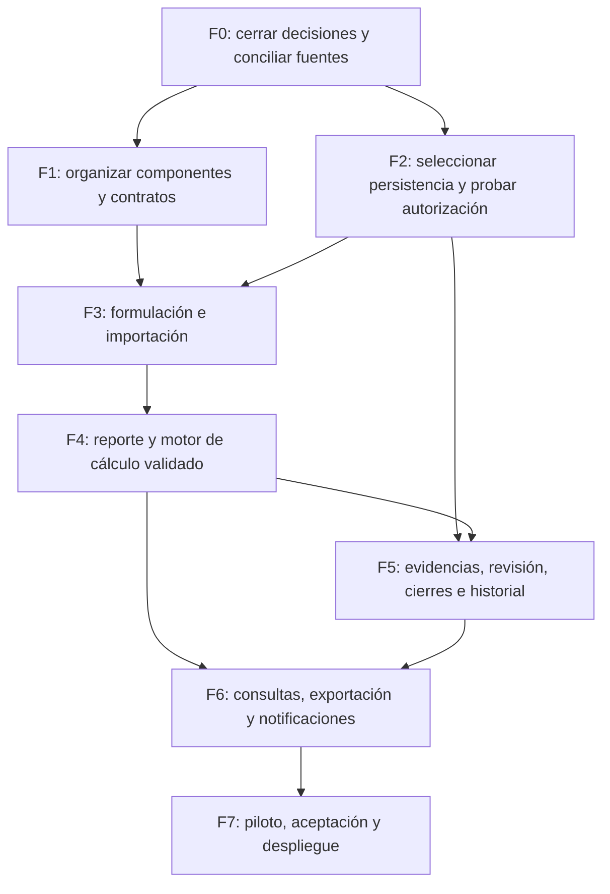

# PAI-008 — Propuesta de implementación funcional por fases

Versión 0.1 para revisión, 16/10/2026. Rama `feature/analisis-funcional-pai`.

## 1. Base y límites

La [arquitectura actual](../arquitectura-actual-pai.md) tiene React, TypeScript, Vite, MSAL y protección de interfaz; los módulos de negocio son demostrativos. Esta propuesta se apoya en [PAI-002](../02-requisitos/PAI-002_Matriz_Requisitos.md), [PAI-003](../02-requisitos/PAI-003_Reglas_Negocio.md), [PAI-004](../02-requisitos/PAI-004_Pendientes_Planeacion.md), [PAI-005](../03-arquitectura/PAI-005_Modelo_Datos_Conceptual.md), [PAI-006](../03-arquitectura/PAI-006_Diccionario_Excel.md) y [PAI-007](../03-arquitectura/PAI-007_Alternativas_Persistencia.md).

El [cuestionario respondido](<../../insumos/planeacion/PAI_Digital_Revision_Requisitos_Planeacion cuetionario resuelto..docx>), §7, acepta con ajustes: no habilita implementar por suposición reglas no definidas. El [Excel V1 (6)](<../../insumos/planeacion/01. Plan de Acción 2026 Consolidado V1 (6).xlsx>) es fuente de evidencia, no dataset depurado ni fórmula única certificada. Las funcionalidades de los HTML son referencias visuales.

No se implementó ninguna fase en este encargo ni se modificó React/MSAL/configuración/estilos. No se estiman fechas, personas ni costes sin dimensionar el alcance. Los criterios siguientes son propuestos y deben validarse con Planeación. Cada fase se entrega con evidencia y aprobación antes de promover datos o reglas oficiales.

## 2. Dependencias principales

Pueden diseñarse pantallas y contratos en paralelo mientras se resuelven decisiones independientes. Sin embargo, ninguna interfaz provisional debe presentarse como escritura segura, cálculo oficial o aprobación institucional. Las evidencias y la base del historial deben diseñarse antes del primer reporte persistente, aunque su flujo completo se entregue en F5.

## 3. Fases, criterios y pruebas

| Fase | Alcance y RF | Dependencias / decisiones de entrada | Criterio de salida propuesto | Pruebas y evidencia |
|---|---|---|---|---|
| F0. Especificación y conciliación | Ratificar requisitos con ajustes, catálogos, fórmulas, roles, fuente maestra y horizonte | P-01–10, P-14, P-16–20 según alcance | Planeación registra decisiones y resultados de casos CAL; archivo de referencia y equivalencias aprobados, sin correcciones tácitas | Revisión por muestra y por totales; explicar 789/785, pesos, #REF!, años/cortes y diferencias E/G; acta de decisiones |
| F1. Modularización sin cambio funcional | Extraer layout, catálogo y vistas de `App`, contratos de dominio/servicios y estados de UI | Base A; acuerdos suficientes para contratos, sin conexión real | Se conservan diseño, seis accesos, búsqueda, menú móvil y protección MSAL; componentes separados por funcionalidad | `npm run build`; regresión visual/teclado/móvil; acceso/salida/recarga/cancelación en navegador controlado |
| F2. Persistencia y autorización | Prueba de alternativas, contratos de datos/documentos, permisos efectivos y concurrencia | P-03/04/13/15/16/17; PAI-007 | Decisión arquitectónica aprobada, matriz aplicada en servicio/origen, operaciones recuperables y plan de conservación | Accesos cruzados por ID/URL, usuario sin asignación, doble rol, eTag/versión obsoleta, fallo parcial, volumen simulado y recuperación |
| F3. Formulación e importación | RF-001–008, 016–017; EXT-01; estructura por vigencia, creación individual, programación y peso | F1/F2; P-05/07/08/14/19/20; reglas de cambios y fuente piloto | Se importa una copia aprobada con vista previa y sin duplicados; Planeación administra solo lo permitido; trazabilidad por archivo/hoja/fila y versiones | Importación repetida, datos incompletos, códigos ambiguos, 50/120 %, actividades con mismo texto, metas congeladas y simulación de cambio autorizado |
| F4. Reporte y medición | RF-009–014, 019; captura de logros y resultado de indicador separados; cálculo versionado | F3; P-01/02/06/18/20; casos esperados aprobados | Guardado y recuperación por ficha/periodo, permisos reales, cantidades y narraciones diferenciadas, cálculos conciliados | CAL-01–08 de PAI-003; enteros/decimales, blanco/cero/no aplica, periodos futuros, exceso, atraso, negativos según regla; doble edición y aislamiento entre fichas |
| F5. Evidencias, revisión e historial | RF-020–022; solicitudes de cambio/reapertura y modificaciones poscierre | F2/F4; P-03/04/05/06/15; historial base previsto desde F2/F3 | Se vincula versión de archivo a versión de reporte; aprobación/devolución y apertura respetan roles; no se pierde observación ni corte previo | Carga interrumpida, URL no autorizada, cambio de evidencia tras devolución, intento poscierre, autorización del vicerrector sin apertura ejecutada, apertura por Planeación, informe de cambios y doble decisión |
| F6. Consulta, informes y avisos | RF-015, 023–026; consolidado, dashboard, exportación Excel, consulta histórica y notificaciones aprobadas | F4/F5; P-08/09/10/11/12; datos/cortes de referencia | Filtros y cifras reconciliados; distinción actividad/indicador; exportación reproducible; avisos solo conforme a calendario/destinatarios acordados | Comparar conteos y valores por unidad/meta/trimestre; exportación del corte original/corregido; no filtrar solo en cliente; aviso duplicado, destinatario incorrecto y reintento; pruebas sin correos reales no autorizados |
| F7. Piloto y liberación controlada | Aceptación funcional, capacitación, operación y despliegue | F0–F6 del alcance comprometido; decisiones críticas cerradas; licencias y soporte confirmados | Planeación acepta resultados; Sistemas valida seguridad/operación; incidencias clasificadas, rollback y recuperación probados | Recorrido integral, restauración, carga y monitoreo, accesibilidad, permisos, sesión real Microsoft 365 y conciliación final; evidencias firmadas/registradas |

El histórico de RF-026 puede entregarse progresivamente: consulta de periodos generados por el nuevo sistema y, por separado, migración histórica autorizada. No comprometer importar todas las hojas 2026 en F3/F6 sin resolver P-09.

## 4. Organización del desarrollo propuesta

Conservar la estructura modular propuesta en A §9: `app`, `components/layout`, `features` para los seis módulos, `domain` para modelos/cálculos y `services/contracts` con adaptadores de datos. No añadir una librería por categoría sin necesidad y evaluación. F1 no debe reemplazar la arquitectura ni alterar la autenticación.

La futura implementación debe separar:

- **Identidad:** MSAL existente; no reimplementar login ni introducir permisos Graph por defecto.
- **Autorización:** asignaciones y capacidades aprobadas, verificadas en cada operación del servicio/origen.
- **Dominio:** fórmula y transiciones versionadas con casos esperados, sin depender del HTML de un prototipo.
- **Datos:** consultas paginadas y filtradas en origen, control de concurrencia y recuperación de fallos.
- **Presentación:** formulario/tabla/estado accesible, con datos de demostración claramente diferenciados hasta integrar persistencia.

## 5. Plan de pruebas transversal

| Nivel | Casos prioritarios | Evidencia de aceptación |
|---|---|---|
| Documental | 26 RF con estado, ajustes, fuentes y criterio CA; reglas y roles sin contradicciones ocultas | Trazabilidad RF → RN/P → entidad → fase → prueba |
| Unitario de dominio, futuro | Cálculo por tipo, pesos, precisión, no aplica, vigencias y transiciones | Resultados esperados aprobados y pruebas repetibles; no duplicar mecánicamente la implementación |
| Integración, futuro | Datos/documentos, concurrencia, operación repetida, permisos, fallos y recuperación | Respuestas y persistencia verificadas en entorno de prueba |
| Navegador, futuro | Login/salida/recarga y acceso bloqueado; formularios; móvil/teclado; devolución/corrección | Registro real de ejecución; no sustituir por build o mocks de MSAL |
| Datos | Comparación de fichas y consolidado, faltantes, referencias, códigos, textos variables y series anómalas de año/corte | Cada hallazgo resuelto o excluido con motivo y aprobación; origen preservado |
| Seguridad, futuro | Lectura/escritura de otra ficha, acceso directo a archivos, edición de cierre, autoaprobación, roles revocados | Denegación efectiva en origen/API y trazabilidad, no solo desaparición de botones |
| Operación, futuro | Retención, restauración, exportación de corte y corrección poscierre | Reconstrucción del informe y soporte revisados, con responsables y procedimiento |

## 6. Priorización y condiciones de salida

Primer incremento sugerido: identidad existente + catálogos conciliados + formulación y programación con controles, antes de métricas oficiales. Segundo incremento: reporte con cálculo validado, evidencias y revisión segura. Tercero: consulta consolidada, exportaciones, avisos e histórico autorizado. El orden no permite posponer la autorización y el historial hasta después de almacenar información oficial.

Para declarar una capacidad terminada se propone exigir: requisito y regla aprobados con alcance, permisos efectivos, pruebas pertinentes, mensajes de error, trazabilidad de datos/versiones y aceptación por responsables competentes. Un módulo visual no es evidencia de aceptación de su flujo de negocio. La advertencia actual de tamaño del paquete no impide análisis documental; la carga diferida puede evaluarse al modularizar, sin ocultar avisos de compilación.

## 7. Riesgos y mitigaciones

| Riesgo | Consecuencia | Mitigación / dependencia |
|---|---|---|
| Adoptar fórmula por mayoría de celdas | Cumplimiento incorrecto o no reproducible | P-01; casos firmados y versión de regla |
| Promediar ejecución como resultado de meta | Indicador de gestión ficticio | P-02; captura/medición separada |
| Migrar consolidado y fichas como duplicados | Doble conteo y metas perdidas | P-14/P-19; reconciliar antes de aplicar lote |
| Confundir rol administrativo con aprobación de su propio PAI | Conflicto de funciones | P-03; matriz y pruebas negativas |
| Usar solo permisos de interfaz | Acceso/edición por otra vía | F2; prueba de origen/API y archivos |
| Corregir poscierre sobrescribiendo información | Pérdida del corte y de observaciones | F5; versiones, autorizaciones y eventos |
| Elegir Lists antes de probar reglas/volumen | Restricciones tardías y rediseño | P-13; prueba comparada y decisión registrada |
| Automatizar recordatorios sin definición | Mensajes erróneos o duplicados | P-11; calendario y destinatarios aprobados |

## 8. Estado de este encargo

Entregados siete documentos de análisis, no funcionalidades nuevas. Se revisaron las 54 hojas mediante celdas almacenadas y las respuestas del cuestionario; no se recalculó el libro en Excel ni se consultó/configuró el tenant. No se realizaron pruebas interactivas Microsoft 365 ni un piloto funcional.

Los insumos institucionales permanecen fuera de los archivos versionados. No se ejecutaron commit, push, Pull Request ni merge. La validación final de este paquete comprueba enlaces, cobertura RF-001–026, integridad de los originales y ausencia de cambios en código/configuración. Los resultados de build del inventario A son antecedentes, no aceptación funcional del PAI.
