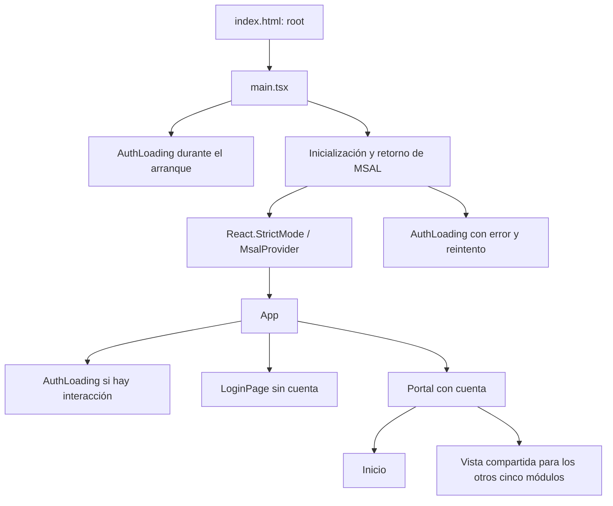

# Inventario técnico y arquitectura actual de PAI Digital

Fecha de revisión: 16 de octubre de 2026.  
Directorio: `D:\PAI\pai-digital-react`.  
Rama inspeccionada: `feature/analisis-funcional-pai`.  
Commit de referencia al iniciar: `fb6c808`.  
Estado inicial: árbol de trabajo limpio.

## 1. Alcance y resultado principal

PAI Digital es una aplicación de una sola página (SPA), ejecutada en el navegador, con React, TypeScript y Vite. Tiene autenticación Microsoft Entra ID mediante MSAL y una protección de presentación que separa espera, acceso y portal autenticado. La navegación, la búsqueda de módulos y el menú adaptable están implementados; las operaciones de negocio de los seis módulos siguen siendo demostraciones visuales.

No hay servicios de persistencia, llamadas a Microsoft Graph, conexión implementada a SharePoint, backend ni autorización de datos en el código revisado. El cliente de Graph está instalado, pero no se utiliza. La documentación plantea integraciones y alojamiento futuros; su presencia en un documento no acredita su implementación o despliegue.

Esta revisión crea únicamente este informe. No modifica componentes, autenticación, configuración ni variables de entorno. Las recomendaciones de las secciones 8 y 9 son propuestas para trabajo posterior, no decisiones funcionales aprobadas ni cambios implementados.

## 2. Estructura de carpetas y archivos

```text
pai-digital-react/
├── .git/                              # Metadatos locales de Git
├── .env.example                       # Nombres de configuración de ejemplo; versionado
├── .env.local                         # Configuración local; ignorada por Git
├── .gitignore
├── README.md
├── index.html                         # Documento HTML en español y punto de montaje #root
├── package.json                       # Dependencias y scripts
├── package-lock.json                  # Resolución de dependencias; lockfile versión 3
├── vite.config.ts
├── tsconfig.json
├── tsconfig.tsbuildinfo                # Información generada por TypeScript; ignorada
├── src/
│   ├── main.tsx                        # Arranque React e inicialización MSAL
│   ├── App.tsx                         # Acceso, estado de navegación y portal
│   ├── styles.css                      # Estilos globales, portal y autenticación
│   ├── vite-env.d.ts                   # Tipos de Vite para import.meta.env
│   ├── auth/
│   │   └── msalConfig.ts               # Configuración MSAL y scopes de acceso
│   └── components/
│       ├── LoginPage.tsx               # Presentación del inicio de sesión
│       └── AuthLoading.tsx             # Espera y error de inicialización
├── referencias/
│   ├── PAI_ciclo_completo.html         # Prototipo HTML independiente
│   └── PAI_validacion_avances.html     # Prototipo HTML independiente
├── docs/
│   ├── 01-inicio/
│   │   ├── .gitkeep
│   │   └── PAI-001_Acta_Inicio.md
│   ├── 02-requisitos/.gitkeep
│   ├── 03-arquitectura/.gitkeep
│   ├── 04-diseno/.gitkeep
│   ├── 05-pruebas/.gitkeep
│   ├── 06-despliegue/.gitkeep
│   └── arquitectura-actual-pai.md      # Este informe
├── node_modules/                      # Dependencias instaladas; ignoradas
└── dist/                              # Resultado de compilación; ignorado
```

La carpeta `docs` ya existía. Sus carpetas de requisitos, arquitectura, diseño, pruebas y despliegue contienen marcadores `.gitkeep`. No se encontraron archivos `AGENTS.md` en el proyecto mediante la búsqueda realizada. No hay directorios de funcionalidades React, servicios, dominio, pruebas o configuración de CI/CD versionados en el inventario actual.

## 3. Tecnologías, dependencias y ejecución

El paquete se identifica como `pai-digital-fumc`, versión `0.1.0`, privado y con `type: module`. Se distinguen los rangos declarados en `package.json` de las versiones observadas mediante `npm ls --depth=0`:

| Dependencia | Rango declarado | Versión instalada | Uso actual |
|---|---|---|---|
| `react` | `^19.0.0` | `19.3.0` | Componentes, estado y referencias |
| `react-dom` | `^19.0.0` | `19.3.0` | Montaje con `createRoot` |
| `@azure/msal-browser` | `^4.0.0` | `4.30.0` | Cliente de autenticación y redirecciones |
| `@azure/msal-react` | `^3.0.0` | `3.0.29` | `MsalProvider` y `useMsal` |
| `@microsoft/microsoft-graph-client` | `^3.0.7` | `3.0.7` | Instalado, sin uso en `src` |
| `lucide-react` | `^0.468.0` | `0.468.0` | Iconos del portal y del acceso |
| `typescript` | `~5.7.0` | `5.7.3` | Comprobación estática |
| `vite` | `^6.0.0` | `6.4.4` | Desarrollo y empaquetado |
| `@vitejs/plugin-react` | `^4.4.0` | `4.7.0` | Integración React/Vite |
| `@types/react` | `^19.0.0` | `19.3.0` | Tipos de React |
| `@types/react-dom` | `^19.0.0` | `19.3.0` | Tipos de React DOM |

Las cinco últimas dependencias son de desarrollo. No hay dependencias declaradas para enrutamiento, formularios, gráficos, validación de esquemas o pruebas. Los estilos son CSS convencional; las fuentes DM Sans y Manrope se solicitan a Google Fonts mediante `@import`, con fuentes alternativas locales.

| Script | Comando | Alcance |
|---|---|---|
| `dev` | `vite --host 0.0.0.0` | Servidor de desarrollo escuchando en las interfaces disponibles |
| `build` | `tsc -b && vite build` | Tipado y compilación de producción |
| `preview` | `vite preview` | Previsualización del resultado compilado |

No existen scripts de lint o pruebas automatizadas. El README pide Node.js 22 LTS; el entorno inspeccionado ejecutó Node.js `18.20.4` y npm `10.7.0`. La compilación pasó con ese entorno. Conviene unificar y declarar la versión de Node del equipo y de la futura automatización; `package.json` no declara `engines`.

## 4. Organización de React y navegación



### Componentes y responsabilidades

| Archivo | Responsabilidad y relaciones |
|---|---|
| [`src/main.tsx`](../src/main.tsx) | Crea una raíz React, presenta espera, prepara MSAL y renderiza `App` dentro de `MsalProvider` y `StrictMode`. |
| [`src/App.tsx`](../src/App.tsx) | Lee MSAL, decide qué pantalla mostrar, contiene los manejadores de acceso y salida y toda la estructura del portal. |
| [`LoginPage.tsx`](../src/components/LoginPage.tsx) | Recibe `onLogin`, `isAuthenticating` y `error`; presenta identidad institucional, botón, instrucciones y error accesible. No configura MSAL. |
| [`AuthLoading.tsx`](../src/components/AuthLoading.tsx) | Muestra espera con `role="status"` y `aria-live`; con `error`, muestra alerta y un botón que recarga la página. |

`App` concentra tanto autenticación como presentación y navegación. El arreglo `sections`, tipado con `Section`, contiene nombre, icono, descripción y encabezado de cada módulo. El arreglo `steps` contiene una hoja de ruta estática; no representa seguimiento conectado a un servicio.

Los estados `active`, `collapsed`, `mobileOpen`, `search` y `showSearch` controlan la interacción visual. `navigate()` cambia el módulo activo, cierra menú móvil y búsqueda y desplaza la página al inicio. La búsqueda filtra nombres de módulos mediante coincidencia de texto, sin distinguir mayúsculas; no busca metas, evidencias ni datos institucionales.

No hay router ni rutas propias por módulo. La selección vive en memoria y no actualiza la URL; al recargar se vuelve a `Inicio`, aunque MSAL pueda restaurar la cuenta. Los cinco módulos distintos de Inicio utilizan el mismo JSX parametrizado por `current` y `CurrentIcon`; no existen cinco componentes funcionales separados.

## 5. Autenticación Microsoft Entra ID mediante MSAL

### Configuración existente

[`src/auth/msalConfig.ts`](../src/auth/msalConfig.ts) construye `msalConfig` con el identificador de aplicación y el identificador de tenant provenientes de variables Vite. La autoridad apunta al tenant configurado en Microsoft; no utiliza una autoridad genérica `common`. Esta inspección local no verifica las opciones del registro de aplicación en Entra.

Las URI de entrada y salida son `window.location.origin + '/'`. La caché es `sessionStorage`. El logger descarta mensajes marcados con información personal y registra los de nivel error. `loginRequest` contiene únicamente `openid` y `profile`; no solicita permisos de acceso a datos de Microsoft Graph.

### Secuencia de arranque

1. `main.tsx` muestra `AuthLoading` antes de esperar la autenticación.
2. Crea `PublicClientApplication`, ejecuta `initialize()` y procesa `handleRedirectPromise()`.
3. Si el retorno trae una cuenta, la establece como activa. Si no, consulta la caché y activa la cuenta cuando existe exactamente una.
4. Un error de redirección se transforma en un mensaje genérico enviado a `App` mediante `initialAuthError`; un fallo de inicialización muestra la pantalla de error con reintento.
5. `MsalProvider` expone instancia, cuentas y progreso a `App` mediante `useMsal`.

### Protección y acciones en App

- La cuenta utilizada es `getActiveAccount() ?? accounts[0] ?? null`.
- Existe presentación autenticada cuando esa cuenta es distinta de `null`.
- Se considera interacción en curso cuando `inProgress !== InteractionStatus.None` o existe una redirección local pendiente.
- Durante una interacción se muestra solo `AuthLoading`; sin cuenta se muestra solo `LoginPage`; con cuenta se muestra el portal.
- `handleLogin` llama `loginRedirect(loginRequest)` y `handleLogout` llama `logoutRedirect` con la cuenta y la URI de retorno.
- `redirectPending`, creado con `useRef`, bloquea llamadas repetidas antes del siguiente render. `isRedirecting` actualiza la presentación inmediatamente. Ante errores se libera el bloqueo y se presenta un mensaje genérico con `role="alert"`.
- El encabezado muestra la inicial del usuario y permite cerrar sesión. La rama de inicio de sesión del encabezado permanece en el JSX, aunque la protección anterior impide llegar al portal sin cuenta.

La restauración depende de la cuenta disponible en la caché de MSAL; no existe un mecanismo propio de persistencia de sesión. En un escenario con varias cuentas sin una activa, `App` toma la primera: no hay selector de cuenta. No se observan llamadas a `acquireTokenSilent` ni adquisición de tokens para servicios de datos.

**Límite:** la presencia de una cuenta controla la interfaz. No constituye autorización sobre dependencias, documentos, SharePoint o futuras API, ni verifica por sí sola permisos o validez de acceso a un recurso de datos. No hay roles o permisos de negocio implementados. Esta tarea no realizó acceso interactivo a Microsoft 365 ni comprobó el registro de Entra en el portal administrativo.

## 6. Los seis módulos: demostración y funciones reales

| Módulo | Presentación disponible | Operaciones de negocio ausentes |
|---|---|---|
| Inicio | Portada, cinco tarjetas de acceso, hoja de ruta y panel informativo estáticos | Resumen institucional obtenido de datos, métricas reales y pendientes de trabajo |
| Gestionar PAI | Encabezado y espacio de trabajo de demostración | Formulación, importación Excel, edición de estructura, programación y persistencia |
| Reporte trimestral | Encabezado y espacio de trabajo de demostración | Formularios, guardado, envío, indicadores y cálculo de cumplimiento |
| Validación de avances | Encabezado y espacio de trabajo de demostración | Bandeja, revisión de evidencias, aprobación, devolución, reapertura e historial |
| Evidencias | Encabezado y espacio de trabajo de demostración | Carga, descarga, metadatos, versiones, almacenamiento y permisos de documentos |
| Dashboard | Encabezado y espacio de trabajo de demostración | Agregaciones, gráficos, filtros de datos, exportación e integración Power BI |

Son funciones reales de interfaz: cambio de módulo, búsqueda de módulos, menú colapsable, apertura/cierre móvil, navegación entre tarjetas y adaptación mediante CSS. También existen las llamadas MSAL de inicio/cierre de sesión, la protección de presentación y los mensajes de error. Su presencia en el código no equivale a una prueba de navegador realizada durante este inventario.

Los HTML de `referencias/` son prototipos independientes y no se importan desde `src`. El de ciclo completo contiene formularios y un selector de archivos, datos fijos, cálculo ilustrativo de ponderación y avisos con `alert`. El de validación contiene datos de ejemplo, filtros DOM, detalle y notificaciones simuladas; `validateAction()` muestra mensajes, sin persistir aprobaciones. Esos controles no son funcionalidades de la aplicación React ni reglas aprobadas que puedan trasladarse automáticamente.

## 7. Configuración y variables de entorno

### Vite

[`vite.config.ts`](../vite.config.ts) solo registra `react()`. No hay alias, proxy, `base`, reglas de partición del paquete ni ajustes de despliegue personalizados. La entrada HTML carga `/src/main.tsx`. La compilación observada produce `dist/`. No hay configuración versionada de Azure Static Web Apps ni workflows de despliegue en el inventario.

### TypeScript

[`tsconfig.json`](../tsconfig.json) utiliza destino `ES2022`, módulos `ESNext`, resolución `Bundler`, JSX `react-jsx` y bibliotecas de navegador. Tiene `strict`, `noUnusedLocals`, `noUnusedParameters`, `isolatedModules` y `noEmit`; Vite genera el paquete final. Incluye `src`, por lo que la comprobación de `tsc` no abarca `vite.config.ts` mediante este archivo. También activa `skipLibCheck`, `resolveJsonModule`, `allowImportingTsExtensions` y `useDefineForClassFields`.

[`src/vite-env.d.ts`](../src/vite-env.d.ts) referencia `vite/client`; no declara una interfaz propia con nombres y requisitos de las variables institucionales. No se encontró validación explícita de configuración obligatoria antes de construir MSAL.

### Variables: nombres y uso, sin valores

| Variable | Archivo de ejemplo | Presente en archivo local | Uso en código |
|---|---|---|---|
| `VITE_ENTRA_CLIENT_ID` | Sí | Sí | `msalConfig.auth.clientId` |
| `VITE_ENTRA_TENANT_ID` | Sí | Sí | Construcción de la autoridad de Entra |
| `VITE_SHAREPOINT_SITE_ID` | Sí | No | Sin referencias en `src`; integración futura |

Se inspeccionaron únicamente los nombres de las asignaciones; no se imprimieron sus valores. Presencia no implica corrección ni validación contra Microsoft. `.env.example` está versionado; `.env.local` está ignorado y no aparece en `git ls-files`. `.gitignore` también excluye `.env`, `node_modules`, `dist` y `*.tsbuildinfo`. No excluye de forma general cualquier variante `.env.*`; conviene revisar el patrón al introducir otros archivos locales de configuración.

Las variables `VITE_` usadas por el frontend forman parte de la configuración visible para el navegador. No deben contener secretos de cliente, contraseñas ni credenciales. Este informe no reproduce identificadores, valores locales ni tokens.

## 8. Elementos reutilizables

| Elemento | Estado actual | Reutilización propuesta |
|---|---|---|
| `LoginPage` | Componente separado y configurable por props | Conservar como pantalla institucional de acceso |
| `AuthLoading` | Componente separado de espera/error | Conservar para arranque e interacción MSAL; distinguir después la carga de datos |
| `msalConfig` y `MsalProvider` | Configuración central y proveedor existentes | Mantener una sola configuración e instancia de autenticación por arranque |
| `sections` | Catálogo tipado dentro de `App` | Extraer posteriormente a una configuración de navegación con identificadores estables |
| Menú lateral, encabezado y pie | JSX dentro de `App`, sin componentes propios | Extraer a componentes de layout conservando comportamiento y diseño |
| Tarjetas, encabezados y paneles | Patrones JSX/CSS repetibles | Extraer solo cuando exista un uso compartido concreto |
| Buscador de módulos | Lógica y presentación locales | Convertir en componente del layout, manteniendo su alcance de navegación |
| CSS e iconos | Estilos institucionales y `lucide-react` | Conservar identidad; separar estilos por responsabilidad de manera gradual |
| HTML de referencia | Prototipos sin integración | Usar como evidencia de diseño, sin copiar cálculos ni permisos como reglas oficiales |

Actualmente no existen componentes React reutilizables de formularios PAI, tablas funcionales, carga de evidencias o gráficos. Proponer su extracción no significa que ya estén disponibles. La parte inicial de `styles.css` está muy condensada y combina estilos globales con los de módulos; una futura separación debe comprobar que conserva la presentación actual.

## 9. Organización modular propuesta

La siguiente estructura es una propuesta incremental. No se crearon estas carpetas ni se agregaron dependencias:

```text
src/
├── main.tsx
├── App.tsx                              # Composición de acceso, layout y vistas
├── app/
│   ├── navigation.ts                    # Catálogo y selección de módulos
│   └── providers/                       # Composición de proveedores, si crece
├── auth/
│   ├── msalConfig.ts                    # Configuración actual
│   └── useInstitutionalAuth.ts          # Extracción futura de estado/acciones
├── components/
│   ├── LoginPage.tsx                    # Reutilizar componente existente
│   ├── AuthLoading.tsx                  # Reutilizar componente existente
│   ├── layout/                         # AppLayout, Sidebar, Topbar, Footer
│   └── ui/                             # Campos, tablas, avisos y estados compartidos
├── features/
│   ├── inicio/
│   ├── gestion-pai/                     # Estructura, formulación e importación
│   ├── reporte-trimestral/              # Captura y presentación de reportes
│   ├── validacion-avances/              # Revisión e historial de decisiones
│   ├── evidencias/                      # Archivos y metadatos documentales
│   └── dashboard/                       # Consultas, agregaciones y exportaciones
├── domain/
│   ├── pai/                            # Entidades e identificadores compartidos
│   ├── indicadores/                    # Cálculos puros, tras validar las fórmulas
│   └── permisos/                       # Contratos según requisitos aprobados
├── services/
│   ├── contracts/                      # Interfaces de acceso a datos y documentos
│   └── microsoft365/                   # Adaptadores Graph/SharePoint futuros
├── config/                             # Lectura y validación de configuración pública
└── styles/                             # Base, layout y estilos comunes
```

Dentro de cada funcionalidad, incorporar `pages`, `components`, `hooks`, tipos y pruebas solo según la necesidad real. Los contratos y modelos compartidos deben evitar que un formulario importe detalles internos de otra funcionalidad.

### Responsabilidades y límites

1. **Presentación:** componentes para campos, formularios, tablas, filtros y mensajes. Cada módulo administra su estado de interacción y sus errores; los borradores no deben confundirse con datos guardados.
2. **Dominio:** distinguir estructura del plan, programación, reporte, evidencias, revisión e indicador de resultado. Las fórmulas y transiciones deben proceder de requisitos validados y tener pruebas con ejemplos acordados; no inferirlas de un prototipo HTML.
3. **Servicios:** ocultar a las vistas los detalles de Graph, listas y bibliotecas. Definir interfaces de consulta/escritura, errores, paginación y concurrencia según las fuentes finalmente elegidas. Los datos de demostración deben quedar explícitamente separados.
4. **Identidad y autorización:** conservar MSAL para identidad y diseñar por separado los permisos de negocio. La autorización efectiva debe residir en el servicio u origen de datos correspondiente; esconder un botón no protege una operación. La integración futura requerirá evaluar adquisición de tokens y permisos mínimos, sin ampliar scopes en este trabajo.
5. **Navegación:** mantener primero la navegación existente al extraer layout y vistas. Evaluar un router cuando se necesiten enlaces directos, parámetros, historial atrás/adelante o recuperación de una vista por URL; no es requisito añadirlo para dividir componentes.
6. **Estilos:** extraer progresivamente estilos por componente o módulo y reservar la base global para tipografía y reglas comunes. Mantener foco visible, mensajes accesibles, contraste y comportamiento móvil.
7. **Pruebas:** priorizar cálculos e invariantes de dominio, estados de acceso y flujos de reporte/revisión; después añadir pruebas de integración y de navegador. No hay infraestructura de pruebas instalada en el estado inventariado.

### Orden de evolución recomendado

1. Actualizar posteriormente los textos desfasados y consolidar requisitos, diccionario de datos, permisos y fórmulas con Planeación.
2. Extraer layout, catálogo y vistas sin modificar su comportamiento; conservar la protección MSAL.
3. Definir modelos y contratos de persistencia antes de conectar formularios a fuentes reales.
4. Incorporar formularios de formulación y reporte con validación, guardado y manejo de errores según requisitos aprobados.
5. Integrar evidencias, validaciones e historial con autorización efectiva y control de modificaciones.
6. Construir dashboards y exportaciones sobre datos consolidados verificables, diferenciando cumplimiento de actividades de resultado de indicadores.
7. Considerar carga diferida de módulos cuando exista separación funcional y medir su efecto sobre el paquete de producción.

Esta propuesta no incorpora reglas nuevas, asignaciones de roles ni aprobaciones automáticas.

## 10. Hallazgos y pendientes técnicos

- `README.md` aún presenta el registro de Entra y MSAL como etapa futura, aunque el código ya los incorpora. Su afirmación sobre falta de conexión debe interpretarse separando identidad de integración de datos.
- `App.tsx` conserva un texto que dice que la autenticación no está implementada. La hoja de ruta y la vigencia 2026 están codificadas, sin sincronización con un sistema de gestión. Se documenta la diferencia sin editar los componentes.
- La navegación depende de etiquetas de texto y `sections.find(...)!`; una evolución futura puede usar identificadores estables y resolver selecciones desconocidas explícitamente.
- No hay autorización de negocio, persistencia, auditoría, cálculo institucional, integración Graph ni repositorio de evidencias implementados.
- No hay lint, pruebas automatizadas configuradas ni automatización de despliegue versionada en el inventario.
- Existe diferencia entre la versión Node documentada y la usada localmente. Conviene definir una versión común y una instalación reproducible basada en el lockfile.
- El paquete principal supera el umbral de aviso de Vite. Es una oportunidad de optimización futura, no un fallo de compilación ni una medida por sí sola del rendimiento real.
- La configuración local no permite acreditar registro de Entra, permisos efectivos, despliegues o seguridad de servicios externos. No se realizaron esas verificaciones.

## 11. Verificaciones ejecutadas

Se comprobó la rama solicitada antes de crear el informe. Se inspeccionaron el estado de Git, inventario de archivos versionados, dependencias instaladas y nombres de variables de entorno. No se consultaron ni imprimieron valores sensibles.

`npm run build` terminó con código de salida **0**:

```text
tsc -b && vite build
Vite 6.4.4
1737 módulos transformados
dist/index.html:                    0.36 kB (gzip 0.27 kB)
dist/assets/index-QbksY7k1.css:     17.94 kB (gzip 4.75 kB)
dist/assets/index-Cc1kMaQs.js:     543.48 kB (gzip 149.63 kB)
```

TypeScript y Vite completaron la compilación. Vite advirtió que un chunk supera 500 kB después de minificar. No se modificó la configuración para ocultar ese aviso. `dist` y el archivo de información de TypeScript son artefactos generados ignorados por Git.

No se ejecutaron pruebas interactivas de Microsoft 365 ni recorridos de navegador. No hay scripts de lint o pruebas que ejecutar. Compilar no acredita comportamiento funcional, accesibilidad completa o autorización de datos. No se realizaron commit, push, Pull Request ni merge.

## 12. Fuentes locales revisadas

- Código: [`src/App.tsx`](../src/App.tsx), [`src/main.tsx`](../src/main.tsx), [`src/auth/msalConfig.ts`](../src/auth/msalConfig.ts), [`src/components/LoginPage.tsx`](../src/components/LoginPage.tsx), [`src/components/AuthLoading.tsx`](../src/components/AuthLoading.tsx), [`src/styles.css`](../src/styles.css) y [`src/vite-env.d.ts`](../src/vite-env.d.ts).
- Configuración: [`package.json`](../package.json), metadatos de [`package-lock.json`](../package-lock.json), [`vite.config.ts`](../vite.config.ts), [`tsconfig.json`](../tsconfig.json), [`index.html`](../index.html) y [`.gitignore`](../.gitignore).
- Entorno: nombres de variables en `.env.example` y `.env.local`, sin sus valores; versiones de Node, npm y dependencias instaladas.
- Documentación: [`README.md`](../README.md) y [`PAI-001_Acta_Inicio.md`](01-inicio/PAI-001_Acta_Inicio.md).
- Referencias visuales: estructura e interacciones de [`PAI_ciclo_completo.html`](../referencias/PAI_ciclo_completo.html) y [`PAI_validacion_avances.html`](../referencias/PAI_validacion_avances.html).
- Git: rama actual, commit de referencia, archivos versionados, exclusiones y estado del árbol de trabajo. No se consultaron servicios remotos.
